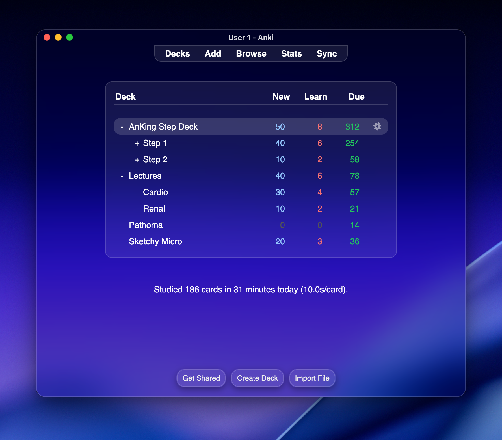
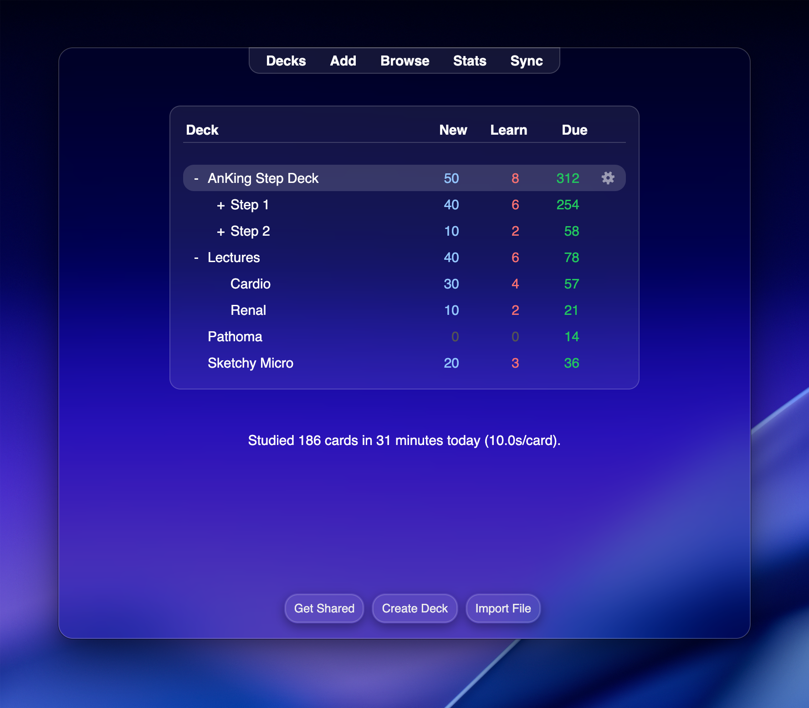

# AnkiBare

A minimalist macOS add-on that hides Anki's window title bar for a clean, bare look.

The title bar is made transparent and its space is reclaimed by the content, and
the traffic-light buttons (close / minimize / zoom) are removed. The window stays
*titled* underneath, so macOS keeps its **rounded corners** and native shadow — it
just looks headerless.

## Behavior

- **No visible title bar or window buttons** — the header space is given back to
  Anki's content.
- **Rounded corners preserved** — because the window remains titled, macOS keeps
  rounding it (a fully borderless window would be square).
- **Dragging still works** — the (now invisible) title-bar strip along the top is
  still a drag handle, so you can reposition the window normally.
- **Resizing still works** — from the window edges and corners, as usual.
- Close / minimize with the usual shortcuts (⌘W, ⌘M) or the menu bar, since the
  buttons are gone.

Great on its own, and pairs cleanly with translucent-window add-ons (e.g.
AnkiGlass) since the rounded shape is kept.

## Requirements

macOS only. On Windows and Linux the add-on loads and does nothing.

## Before:

## After:

Shown with [AnkiGlass](https://github.com/AIbrahimv2/AnkiGlass), which gives Anki's main window macOS Liquid Glass.

## Development

`python3 tools/screenshots.py` renders `docs/before.png` and `docs/after.png`
(used here and on AnkiWeb) with the add-ons' shared screenshot tools in the
kit (`../anki-addon-kit/screenshots`): Anki's own pages in AnkiGlass, on macOS
Tahoe's dark wallpaper.
