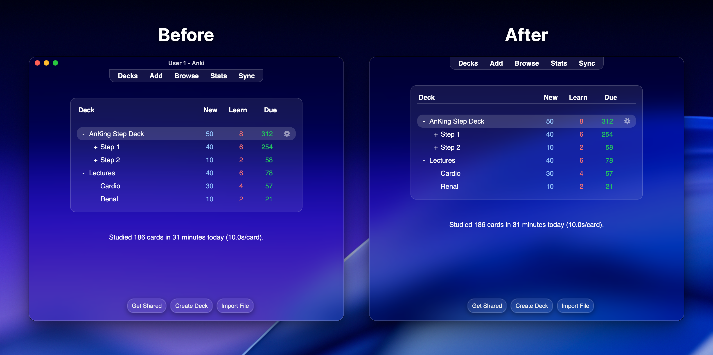

# AnkiWeb listing

What's live at https://ankiweb.net/shared/info/1505882046. Edit it at
https://ankiweb.net/shared/upload?id=1505882046 (the `anki-addon-release`
skill has the steps), and update this file in the same session.

## Package on AnkiWeb

Version 1.1.0, uploaded 2026-11-17. The release script (`release.py --uploaded`
in the `anki-addon-release` skill) updates this line after each upload.

## Title

🐻 AnkiBare: remove Anki's macOS title bar for a clean, bare window

## Tags

hide title bar remove title bar titlebar hide traffic light buttons window buttons minimal minimalist clean modern bare ui borderless macos mac rounded corners tiling window manager yabai

## Search

Searched on 2026-11-15, before and after the tags above replaced the old
ones, with the `ankiweb_search.py` approach from the `anki-addon-release`
skill. "Results" is how many add-ons match now. AnkiWeb sorts results by
ratings, so an add-on without ratings comes after every rated match; the
words only decide whether it shows up.

- Tags match whole words. "study plan" didn't find the tag "study planner",
  while the title and description match parts of words ("mac" finds
  "macOS"). So the tags spell out the exact words people type.
- Neighbouring tags read as a phrase, so their order matters.
- Left out on purpose: "top bar", which was in the old tags: Anki's top bar
  is the Decks/Add/Browse toolbar, which AnkiBare doesn't hide. Also "zen",
  "distraction free", "full screen" and "header", which are other add-ons'
  jobs.

| Search | Results | Before | After |
| --- | --- | --- | --- |
| title bar | 10 | #6 | #6 |
| titlebar | 5 | absent | #5 |
| hide title bar | 2 | absent | #2 |
| remove title bar | 1 | absent | #1 |
| traffic light | 2 | absent | #1 |
| window buttons | 3 | not run | #3 |
| borderless | 3 | absent | #3 |
| rounded corners | 8 | absent | #4 |
| minimal | 115 | #68 | #62 |
| minimalist | 39 | #21 | #17 |
| clean | 361 | #180 | #179 |
| modern | 168 | #81 | #75 |
| macos | 371 | #142 | #168 |
| tiling | 26 | #17 | #17 |
| window manager | 4 | #2 | #2 |
| aerospace | 1 | #1 | #1 |
| yabai | 1 | not run | #1 |

## Support page

https://github.com/AIbrahimv2/AnkiBare

## Supported Anki versions

Minimum 24.04, maximum 26.09.4 with no `-`, so newer versions get it too. The
form turns 24.04 into "24.04.0", and the listing shows "24.04-26.09.4+".

Set with 1.1.0 on 2026-11-17. Until then it was 2.1.1 to 2.1.1, the form's
default, so every version got it; anyone on an older Anki keeps 1.0.0.

Why 24.04:

- 1.1.0 adds the shared kit's What's new and About window (src/kit/), a web
  page whose stylesheet uses `color-mix()`, which needs Chromium 111. 24.04
  is the first release whose builds all ship Qt 6.6 (Chromium 112), and it's
  the minimum of AIbrahimv2's other add-ons.
- AnkiBare's own code (the title bar, through AppKit with ctypes) isn't tied
  to an Anki version.

Not tested on 24.04 itself: the code compiles on its Python 3.9, and the kit
passes Stepwise's and Exam Timeline's tests there (`tests/run_on_anki.sh 24.4`
in those repos).

## Description

Paste as is. AnkiWeb takes Markdown and basic HTML. It follows the layout in
the `anki-addon-release` skill's listing conventions: what it does, the code
line and the screenshot first, the signature last.

Until 2026-11-16 it described the March version, whose window couldn't be
dragged; 1.0.0 keeps an invisible title bar strip that still drags it.

```markdown
Hide Anki's title bar on your Mac for a clean, bare window. The title bar and its close, minimize and zoom buttons disappear, and their space goes to Anki's content.

**macOS only.** On Windows and Linux it does nothing.

**Code: 1505882046.** Paste it in Anki under **Tools → Add-ons → Get Add-ons**.

<p></p>

<p><small>Shown with <a href="https://ankiweb.net/shared/info/1866406123">AnkiGlass</a>, which gives Anki's main window macOS Liquid Glass.</small></p>

**Features**

- The window keeps its rounded corners and shadow.
- Drag it by its top edge as before: the strip is still there, just invisible. Resize it from any edge or corner.
- Close and minimize with ⌘W and ⌘M, or from the menu bar.
- The title bar stays hidden when the window comes back, goes in or out of full screen, or is laid out again.
- Pairs well with translucent-window add-ons like [🫧 AnkiGlass](https://ankiweb.net/shared/info/1866406123), since the rounded shape is kept.

**Good to know**

- Handy with a tiling window manager such as AeroSpace, which places the window for you.

Source, changelog and issues: [github.com/AIbrahimv2/AnkiBare](https://github.com/AIbrahimv2/AnkiBare)

<p><a href="https://abdelrahmanibrahim.com/anki/"></a></p>
```
